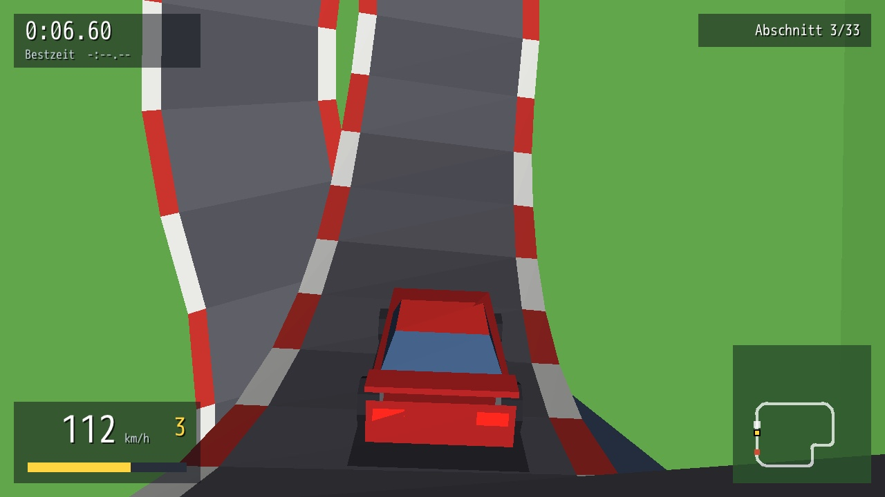
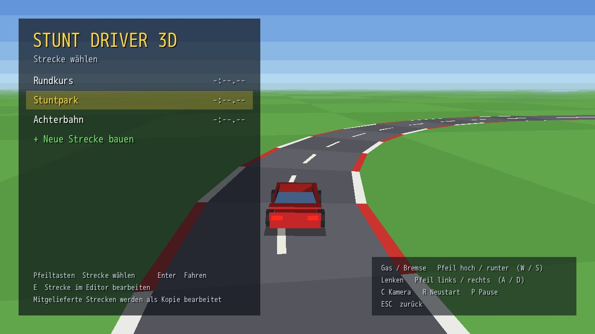
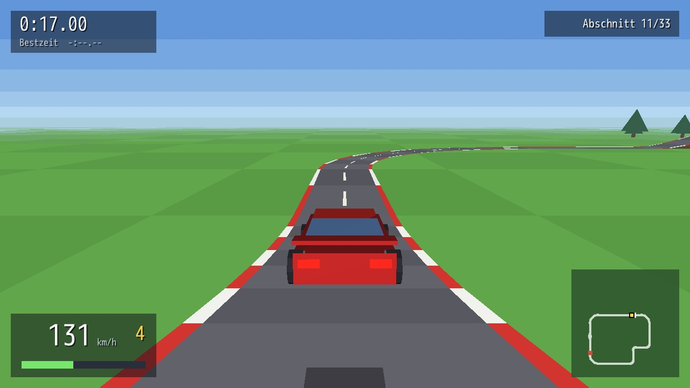
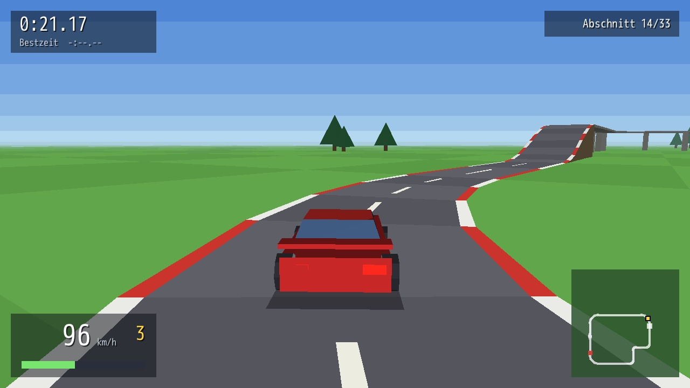
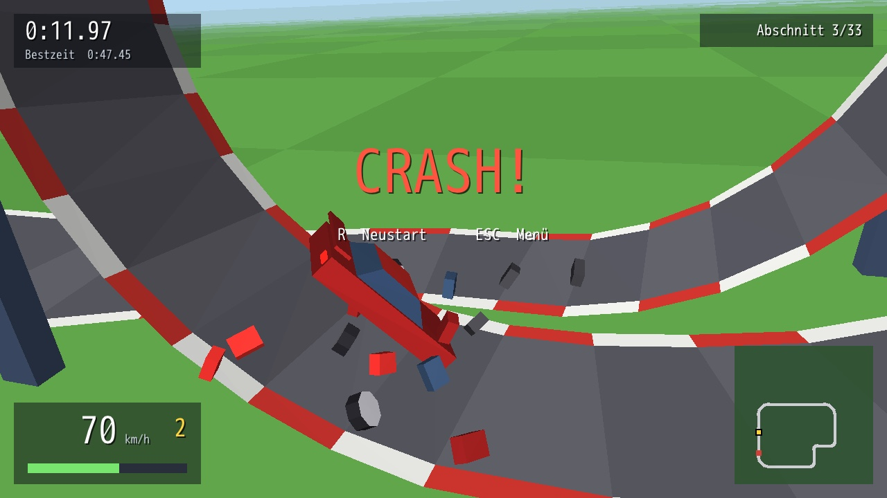
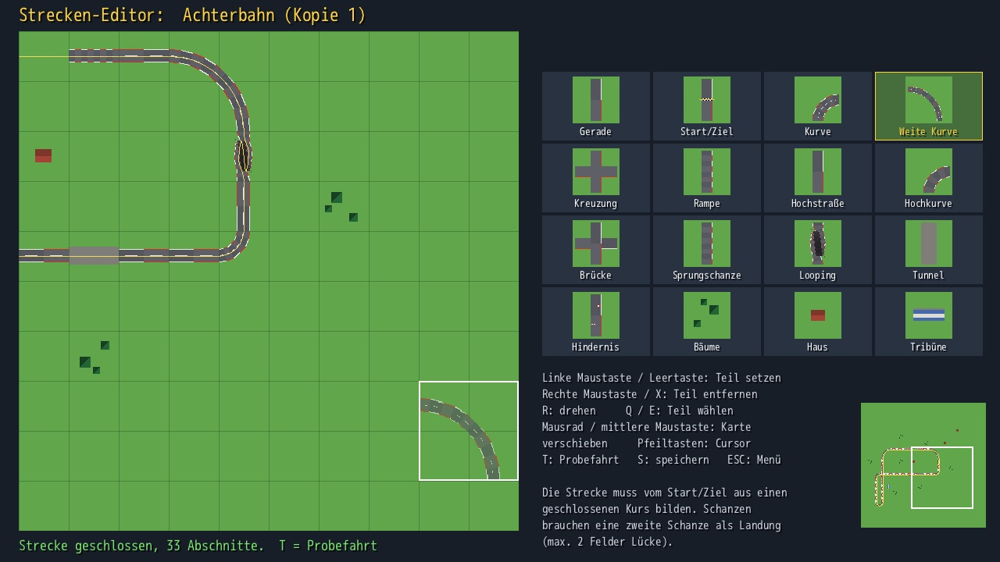

<h1 align="center">Stunt Driver 3D</h1>

<p align="center">
  <b>Loops, jumps, bridges and a stopwatch.</b><br>
  A stunt racing game with a track editor for <a href="https://dragonruby.org/">DragonRuby GTK</a>,
  software-rendered in pure Ruby with the <a href="https://github.com/webmatze/d3d">D3D</a> engine.
</p>

<p align="center">
  
</p>

Race the clock over 3D tracks without wrecking the car, then build your own tracks from the
same parts and test-drive them straight from the editor.

| | |
|---|---|
|  |  |
| **Menu**: pick a track while the autopilot shows it off | **Jumps**: take off fast enough to reach the landing ramp |
|  |  |
| **Heights**: ramps, elevated roads and bridges | **Crash**: too slow for the loop and the run is over |

<p align="center">
  <br>
  <b>Track editor</b>: place parts on the grid; the route is checked after every change
</p>

## Features

- **Stunt tracks** on a 20x20 grid of tiles: curves, wide curves, crossings, ramps, elevated
  roads, bridges, jump ramps, loops, tunnels and slalom obstacles, plus scenery
- **Time trial**: countdown, clock, best time per track, minimap; every part of the track
  has to be driven in order
- **Crashes**: hit something fast, land too hard or not on the wheels and the car is a wreck
- **Track editor** with mouse and keyboard, a live route check and instant test drives;
  up to 8 own tracks saved as plain text
- **Three built-in tracks**, three cameras (chase, far, bonnet), procedurally generated sounds
- **Pure Ruby**: about 2 ms of Ruby per frame on an Apple silicon Mac, no C extension needed

The game's texts are German.

## Run

```bash
smaug run                 # DragonRuby version from Smaug.toml
# or: dragonruby .
```

## Playing

| Key | Action |
|---|---|
| Up / W | Accelerate |
| Down / S, Space | Brake, reverse at standstill |
| Left / Right, A / D | Steer |
| C | Camera: chase, far, bonnet |
| R | Restart the run |
| P | Pause |
| ESC | Back to the menu (or to the editor after a test drive) |

A gamepad works too (stick, A / R2 accelerate, B / L2 brake).

- The clock starts at "LOS!" and stops on the start/finish line once every part of the
  track has been driven in order. Leave a part out and the map shows where to go back to.
- The run ends in a crash when the car hits something fast, lands too hard or not on its
  wheels. Grass only slows it down.
- A loop needs about 80 km/h at its entrance, a jump over one empty tile about 115 km/h,
  over two about 165 km/h.
- Best times are kept per track in `data/times.txt`.

## Track editor

`E` in the menu opens the selected track ("+ Neue Strecke bauen" starts an empty one; a
track that ships with the game is edited as a copy). Up to 8 own tracks are stored as text
files in `tracks/user_N.txt`.

| Input | Action |
|---|---|
| Left mouse button / Space | Place the selected part (drag to paint) |
| Right mouse button / X | Remove the part |
| R | Rotate |
| Click on the palette, Q / E | Choose a part |
| Mouse wheel (Shift: sideways), middle mouse button, click on the overview | Scroll the map |
| Arrow keys | Move the cursor (the map follows) |
| T | Test drive |
| S | Save (also saved when leaving) |

Parts: straight, start/finish, curve, wide curve (2x2 tiles), crossing, ramp, elevated road,
elevated curve, bridge (elevated road over a ground road), jump ramp, loop, tunnel, slalom
obstacle and scenery (trees, house, grandstand). The editor follows the road from the
start/finish line after every change and tells where it ends: a track can be driven once it
forms a closed circuit. A jump ramp needs a second one facing it as the landing, with at
most 2 empty tiles between them. Ground and elevated roads only connect through a ramp.

## How it works

```
app/main.rb               requires + tick
app/d3d/                  the D3D engine (unchanged copy)
app/game/
  geo.rb                  static world geometry: shared vertices, triangles with baked sun light
  pieces.rb               the track parts: connectors, centre lines, geometry, collision
  track.rb                tile grid, text format, route check
  world.rb                a track built for driving: geometry, collision grid, route centre line
  car.rb                  car physics
  race.rb                 countdown, clock, order of the parts, finish
  autopilot.rb            drives the centre line (menu demo, tests)
  builtin_tracks.rb       the three tracks that ship with the game
  gfx.rb                  renderer on top of D3D::SceneRenderer
  models.rb               car, wheels, wreckage
  map_view.rb             top-down drawings for editor, palette and minimap
  hud.rb, editor.rb, game.rb
```

- **Rendering** uses the engine's 6DOF `SceneRenderer` (camera `Pose` with free roll, needed
  in the loop) plus `StuntRenderer`: world triangles with near-plane clipping, a ground
  layer drawn unsorted before everything else, a banded sky and horizon, and haze. To keep
  the painter's algorithm from drawing road over the car, every triangle is tested against
  the car: if the car is on the camera's side of its plane it is drawn before the car,
  otherwise after it.
- **Physics** treats the car as a point with an orientation. A ray along the car's own
  "down" finds the road, so the same code drives on the flat, on ramps and upside down
  through the loop; gravity always acts, so a car that is too slow at the top falls off.
  A second ray along the velocity and two spheres against solid boxes detect crashes.
  The loop gently steers the car along its strip, like a rut.
- **Tracks** are a 20x20 grid of 30 m tiles. Every part declares connectors (tile edge and
  height level) and links between them; the route check walks these from the start line.

## Tests

```bash
ruby tests/game_test.rb                           # game logic with plain Ruby (no DragonRuby)
ruby tools/smoke.rb                               # headless DragonRuby: menu, autopilot lap, crash, editor
ruby tools/smoke.rb --eval tools/smoke_ui.rb      # input polling, new track, test drive, delete
ruby tools/gen_assets.rb                          # regenerate the sounds
```

The unit tests include the autopilot finishing every built-in track and the loop and jump
at different speeds. `tools/smoke.rb` saves screenshots and reports the Ruby time per tick
(about 2 ms on an M-series Mac without the C extension).

The optional D3D Pro C extension is picked up when a `native/` folder is present
(`D3D::Native.load`); the game doesn't need it.
